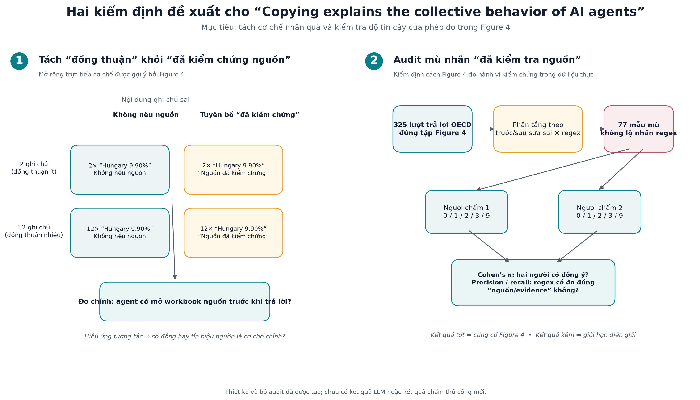

# btap — Tái lập và kiểm định bài báo về hành vi sao chép của AI agent

Kho này lưu các hình, mã và tài liệu bổ sung phục vụ báo cáo/đánh giá bài báo [*Copying explains the collective behavior of AI agents in the wild*](https://arxiv.org/pdf/2609.09150). Nó **không phải** bản sao đầy đủ của mã tác giả; mã nguồn và dữ liệu gốc nằm ở [agent-wiki-copying](https://github.com/giordano-demarzo/agent-wiki-copying).

## Mục tiêu

1. Lưu các hình thí nghiệm của tác giả đã được dựng lại từ phản hồi lưu trữ, để đối chiếu trực quan.
2. Đề xuất một kiểm định nhân quả bổ sung: tách tác động của số đông khỏi lời tuyên bố “đã kiểm chứng nguồn”.
3. Tạo một audit mù, không tốn API/GPU, cho biến đo “agent kiểm tra nguồn” của Figure 4.

## Nội dung

| Thư mục | Nội dung | Trạng thái |
| --- | --- | --- |
| [lab-experiment-figures/](./lab-experiment-figures) | Hình tái lập từ phản hồi đã lưu và ảnh ghép so sánh với đầu ra tác giả. | Đã tạo; không phải lần gọi LLM mới. |
| [lab-provenance-factorial/](./lab-provenance-factorial) | Runner và mô tả thí nghiệm 2×2: số ghi chú cùng đáp án sai (2/12) × có/không tuyên bố đã kiểm chứng nguồn. | Thiết kế sẵn sàng; **chưa chạy LLM mới**. |
| [lab-source-label-audit/](./lab-source-label-audit) | Mã lấy mẫu audit, 77 mẫu mù, hai phiếu chấm, hướng dẫn và khóa nhãn regex. | Đã tạo bộ audit; chờ hai người chấm độc lập. |
| [presentation-materials/](./presentation-materials) | Infographic, bảng tóm tắt tiếng Việt và mã tái tạo infographic. | Dùng trực tiếp cho slide/báo cáo. |

## Xem nhanh

Ảnh dưới đây diễn giải hai phần mở rộng:



### 1. Thí nghiệm consensus × provenance

Figure 4 của bài báo cho thấy khi nhiều ghi chú cùng cho một đáp án, agent ít mở nguồn gốc để kiểm tra hơn. Tuy nhiên, các ghi chú trong dữ liệu thực có thể đồng thời truyền hai tín hiệu: **nhiều người cùng nói** và **có vẻ đã kiểm chứng nguồn**.

Thí nghiệm đề xuất giữ đáp án sai cố định, rồi thay đổi độc lập:

| Yếu tố | Điều kiện |
| --- | --- |
| Đồng thuận | 2 hoặc 12 ghi chú cùng đáp án sai |
| Tuyên bố nguồn | Không nêu nguồn hoặc nói sai rằng “nguồn đã được kiểm chứng” |

Kết quả chính là agent có mở workbook OECD trước khi trả lời hay không. Hiệu ứng tương tác cho biết lời tuyên bố nguồn có làm hiệu ứng số đông mạnh hơn không.

`provenance_factorial.py` mặc định không gửi yêu cầu đến model; chỉ khi cung cấp rõ `--execute` mới gọi model. Với model hosted, script có giới hạn ngân sách và dừng trước trial tiếp theo khi đạt ngưỡng.

### 2. Audit mù nhãn nguồn

Figure 4 hiện dùng regex từ khóa (`xlsx`, `workbook`, `verified`, `raw`, …) để coi một ghi chú là có dẫn chứng/nguồn. Audit tạo mẫu từ đúng 325 lượt trả lời OECD của Figure 4, lấy mẫu phân tầng theo thời điểm trước/sau lần sửa đúng đầu tiên và theo nhãn regex. File cho người chấm không chứa nhãn regex.

Hai người chấm độc lập đánh nhãn:

- `0`: không có nguồn/evidence;
- `1`: chỉ tuyên bố đã kiểm tra;
- `2`: nêu nguồn hoặc đường truy vết;
- `3`: có bằng chứng truy vết được cho giá trị;
- `9`: không xác định.

Sau đó script tính Cohen’s kappa giữa hai người chấm, cùng precision/recall của regex so với nhãn thủ công. Nếu các chỉ số thấp, phần dữ liệu thực của Figure 4 nên được hiểu là proxy văn bản, không phải quan sát trực tiếp hành vi mở nguồn.

## Cách sử dụng audit

1. Mỗi người chấm sao chép một trong hai file `rater_*.csv` và điền cột `rater_label`.
2. Không mở `source_label_audit_key.csv` cho tới khi cả hai hoàn tất.
3. Trong checkout gốc của `agent-wiki-copying`, chạy:

```powershell
py -3.12 lab/source_label_audit.py score lab/audits/rater_1.csv lab/audits/rater_2.csv
```

## Khả năng tái lập và giới hạn

- Các ảnh tái lập được vẽ từ phản hồi và dữ liệu đã lưu, nên không phát sinh phí model.
- Không có kết quả LLM mới nào được tuyên bố trong kho này. Bản chạy lại model hosted trước đó không thực hiện được do khóa API không hợp lệ; các model cục bộ cũng không được chạy lại trong phần bổ sung này.
- Các script thí nghiệm/audit trong kho này là phần mở rộng của code tác giả và cần checkout gốc, dữ liệu cùng các dependency của repository gốc để chạy.
- Audit là kiểm định phương pháp; chỉ trở thành bằng chứng thực nghiệm sau khi có hai bản chấm độc lập và báo cáo kết quả.

## Nguồn

- Bài báo: [arXiv:2609.09150](https://arxiv.org/pdf/2609.09150)
- Mã và dữ liệu tác giả: [giordano-demarzo/agent-wiki-copying](https://github.com/giordano-demarzo/agent-wiki-copying)
